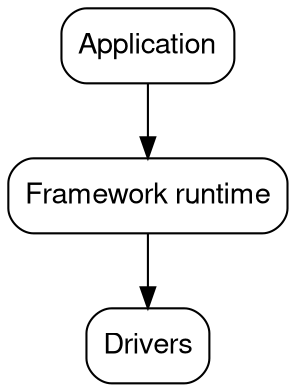

# DOT language essentials

Contents: Skeleton · Graph types · IDs and quoting · Statements and attribute scope · Subgraphs and clusters · Ports · Comments · Escape strings · Pitfalls

## Skeleton



## Graph types

| Header | Edge operator | Use |
|---|---|---|
| `digraph name { }` | `->` | Anything with direction (dependency, flow, transition) |
| `graph name { }` | `--` | Symmetric relations (links, peers, cables) |
| `strict digraph` / `strict graph` | same | Collapses duplicate edges between the same pair (handy for generated graphs) |

Using `--` in a `digraph` or `->` in a `graph` is a syntax error.

## IDs and quoting

An ID is one of the following:
- a name of letters, digits, and `_`, not starting with a digit
- a number (`-1.5`, `.5`)
- a double-quoted string (`"order-service v2"`), with `\"` for an embedded quote
- an HTML string (`< ... >`), which must be well-formed XML (see `labels-html.md`)

`abc` and `"abc"` mean the same thing. Quote anything containing `-`, `.`, `/`, `:`, spaces, or starting with a digit. Keywords used as IDs must be quoted. Long strings can be split with `+`: `"part one " + "part two"`.

## Statements and attribute scope

```dot
graph [rankdir=LR];        // graph attributes (also: plain rankdir=LR;)
node  [shape=box];         // default for nodes declared AFTER this line
edge  [color=gray40];      // default for edges declared AFTER this line
a [label="A"];             // node statement
a -> b [label="calls"];    // edge statement
a -> {b c};                // fan-out: a->b, a->c
{a b} -> c;                // fan-in
a -> b -> c;               // chain (attributes apply to every edge in it)
```

- Defaults apply **from the point of declaration onward**, and only in the current (sub)graph and its children. Put defaults at the top.
- Subgraph-local defaults are the clean way to style a group: `subgraph { edge [style=dashed]; x -> y; }`.
- Attribute lists accept `,` or `;` separators. Use `,` consistently.
- A node is created the first time it's mentioned. Declare it explicitly with its label before using it in edges.

## Subgraphs and clusters

```dot
subgraph cluster_backend {
    label="Backend";
    style="rounded";
    api  [label="API"];
    db   [label="Database", shape=cylinder];
}
```

- `subgraph cluster_*` is drawn as a box by `dot`, `fdp`, and `osage`. Other engines ignore clusters.
- A plain `subgraph { }` (no `cluster` prefix) groups nodes for **scoping** (defaults, `rank=same`) without drawing anything.
- A node belongs to the first cluster it's declared in. Declare it inside the cluster, not in an edge statement above it.
- Clusters can nest. Keep nesting to 2 levels or fewer.
- To draw an edge to or from a cluster boundary: set `compound=true` on the graph, then `a -> b [lhead=cluster_backend]` (`ltail` for the tail). `b` must be a node inside that cluster.

## Ports

- `node:port` or `node:port:compass`, where compass is `n ne e se s sw w nw c _`. Also usable as `headport`/`tailport`.
- Ports are defined by `port="..."` on HTML table cells (preferred) or by `<field>` in record labels.
- `splines=ortho` ignores ports.

## Comments

`// line`, `/* block */`, and lines starting with `#` (preprocessor-style). Use `//` consistently.

## Escape strings (escString)

In `label`, `xlabel`, `tooltip`, `URL`/`href`, and similar:
- `\n` centred line break, `\l` left-justified line break, `\r` right-justified line break. End a left-aligned block with a trailing `\l`.
- `\N` node name, `\G` graph name, `\E` edge name, `\T`/`\H` tail/head name.

## Pitfalls

- An unquoted ID with a hyphen (`order-svc`) or starting with a digit (`2fa`) is a syntax error. Quote it or use `_`.
- `label` set on a graph is also inherited by its subgraphs/clusters. Set an explicit `label` on each cluster, or set the root title via `graph [label=...]` and give clusters their own labels.
- A node declared only inside an edge statement within a cluster still joins that cluster, which can be surprising. Declare nodes explicitly.
- `rank=same` inside a **cluster** is ignored without `newrank=true` on the root graph.
