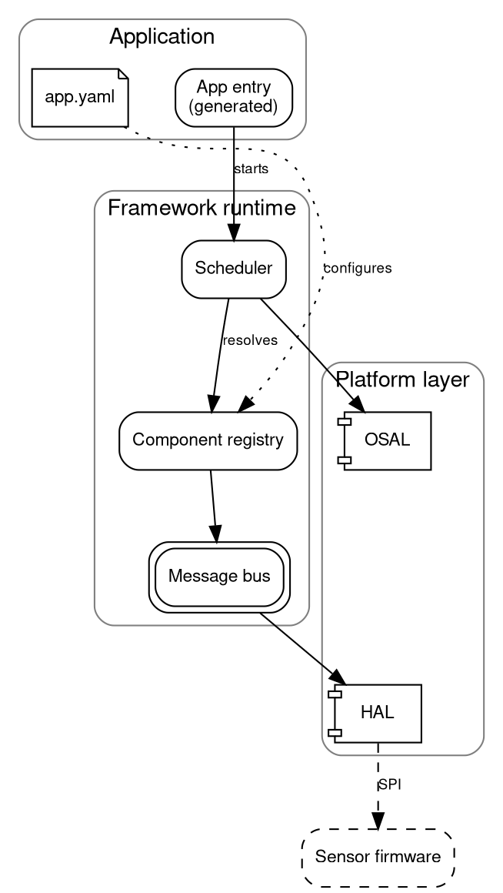

# Pattern: architecture / component view

Answers: which components exist, how they are grouped (layers, processes, deployables), and how they talk to each other.

## Template

## Rules

- **One level of abstraction per diagram.** Don't mix deployables with classes. Do an overview first, then one detail diagram per cluster if needed (C4-style zoom).
- **Clusters = a real boundary** (process, binary, layer, repository, network zone). Name the boundary type in the label if ambiguous ("Backend (container)").
- Layered stacks: `rankdir=TB`, with dependencies pointing **down**. Request paths: `rankdir=LR`, with the caller on the left.
- Label edges with **intent or protocol**, not both, unless both are short (`calls (gRPC)`).
- External systems: dashed outline and outside all owned clusters.
- To show "this whole subsystem depends on X", use one edge from a representative node with `ltail=cluster_x` (requires `compound=true`) instead of N edges.

## Common fixes

- Layers not stacked cleanly: put `{ rank=same; ... }` subgraphs inside each layer cluster (with `newrank=true`), or add invisible edges between layers, commented as `// layout`.
- Config/cross-cutting edges pull nodes around: use `constraint=false`.
- Too many edges: collapse them into "uses" edges between clusters, and move details to a per-cluster diagram.
