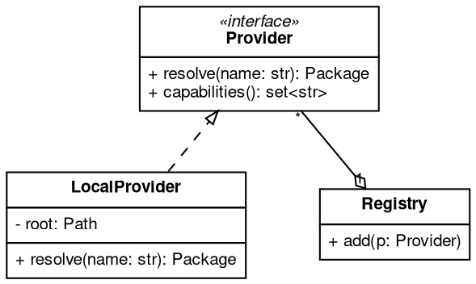

# Pattern: class / UML-style structure

Answers: which types and interfaces exist, and how they relate (inherit, implement, own, use). For Python classes in Sphinx, prefer the generated `sphinx.ext.inheritance_diagram` over hand-drawn graphs.

## Template

## UML edge mapping

| Relationship | DOT (edge written from child/part to parent/whole unless noted) |
|---|---|
| Inheritance (extends) | `child -> parent [arrowhead=empty]` |
| Realisation (implements) | `impl -> iface [arrowhead=empty, style=dashed]` |
| Association (navigable) | `a -> b [arrowhead=vee]` |
| Dependency (uses) | `a -> b [arrowhead=vee, style=dashed]` |
| Aggregation | `whole -> part [dir=back, arrowtail=odiamond]` |
| Composition | `whole -> part [dir=back, arrowtail=diamond]` |
| Multiplicity | `headlabel` / `taillabel` (`1`, `0..*`) |

`dir=back` keeps the whole above or before the part in the ranking while drawing the diamond at the whole.

## Rules

- `rankdir=BT`, so arrows to base classes point **up**.
- Three sections: name / attributes / operations. Omit empty sections. Show only members relevant to the point being made.
- Visibility markers `+ - # ~`. Italic for abstract and interface names. Stereotypes as `&laquo;interface&raquo;`.
- Escape generics: `set&lt;str&gt;`.
- Keep it to about 10 classes or fewer. Group by module with clusters if needed.
