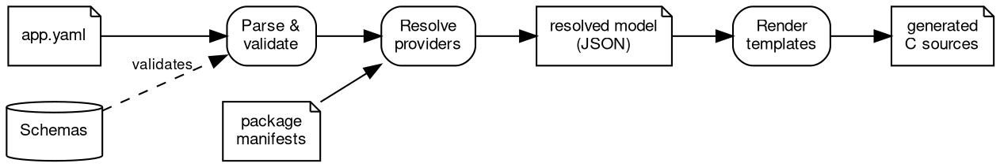

# Pattern: data flow / pipeline / CI flow

Answers: how data or work moves through stages, what each stage produces, and where it branches, merges, or stores.

## Template

## Rules

- `rankdir=LR`, so the flow reads like text. Use `TB` only for long, narrow pipelines.
- **Separate artefacts from processes:** artefacts (files, messages) are `note`/`cylinder`, and processes are rounded boxes. Alternating artefact and process makes the diagram self-explanatory. For pure CI job flows, process nodes alone are fine.
- Keep the main path straight with `weight` on its edges, and declare it first. Side inputs come after.
- Loops (retry, feedback): `constraint=false`, or `dir=back` on a reversed edge, so they don't fold the layout.
- Parallel stages: put them in `{ rank=same; a; b; }`, with explicit fan-out and fan-in nodes (`shape=point` works as a join bar).
- CI-specific: one cluster per stage (build/test/deploy), jobs as nodes, and dashed edges for `needs`/artefact handoff vs solid edges for sequence.

## Data flow diagram (DFD) notation

If the doc uses DFD vocabulary: external entities as `box`, processes as `ellipse` or `Mrecord`, data stores as `cylinder`, flows labelled with the data name. Don't connect two stores or two external entities directly.
