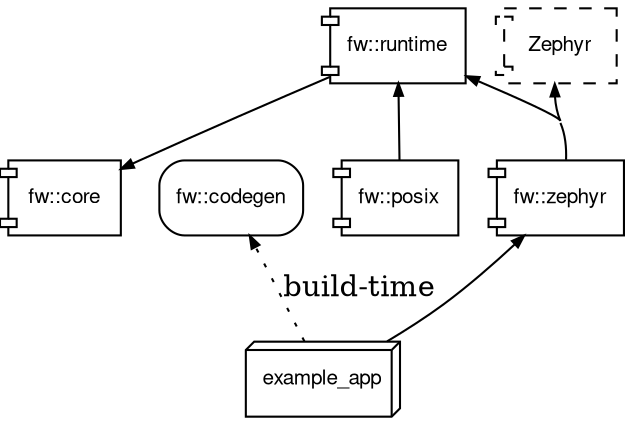

# Pattern: dependency graph (packages, build targets, modules, includes)

Answers: what depends on what, what is public vs private or build vs runtime, and where the layering is.

## Template

## Rules

- **The arrow points from dependant to dependency** (`app -> lib`). State this in the caption. Never mix directions.
- `rankdir=BT` puts foundations at the bottom (a "stack" mental model). `TB` with consumers at the top also works. Pick one per doc set.
- Distinguish dependency kinds by line style: public/runtime solid, private dotted-grey, build-time/tool dotted, optional dashed. Add a legend if you use more than one.
- Shapes by artefact kind: `component` for library/package, `box3d` for executable/app, `rounded box` for tool, `dashed` for external/third party.
- **Show only direct edges.** Transitive edges add noise. For generated graphs, run a transitive reduction (`tred deps.dot`) before publishing.
- Highlight layering violations or cycles explicitly (`penwidth=2` plus a label like "cycle!"). They're often the point of the diagram.

## Large graphs

- Set `concentrate=true`, and collapse each package's internal targets into one node.
- Filter generated graphs to the subsystem being discussed.
- `strict digraph` removes duplicate edges from merged generator output.
- `unflatten -l 3 deps.dot | dot -Tsvg` helps wide, flat graphs with many leaves.
