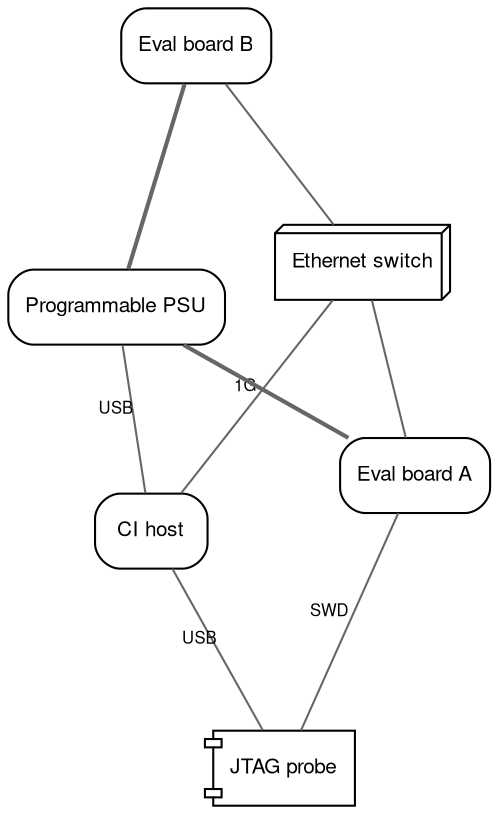

# Pattern: network / topology (undirected interconnection)

Answers: which peers, devices, or services are connected, and how they're grouped, when there's no natural direction or hierarchy.

## Template

## Engine choice

| Structure | Engine |
|---|---|
| Small mesh, no groups | `neato` (`overlap=false`, `splines=true`) |
| Groups/zones matter | `fdp` with `subgraph cluster_*` |
| Hub and spokes | `twopi` with `root=` |
| Ring / bus | `circo` |
| Hundreds of nodes, overview only | `sfdp` with `overlap=prism` |
| Physical placement matters (racks, boards) | `neato` with pinned `pos="x,y!"` |

## Rules

- Use `graph` with `--`. If the link direction matters (traffic flow), use a `digraph` with `dot` instead.
- Label links with the medium or protocol (`USB`, `SPI`, `1G`). Encode the link type with line style (power `bold`, data solid, debug dashed) and add a legend.
- Force-directed layouts aren't deterministic across versions. Don't describe positions in prose ("the board on the left").
- Use `start=<seed>` with `neato`/`fdp` for reproducible renders between builds.
