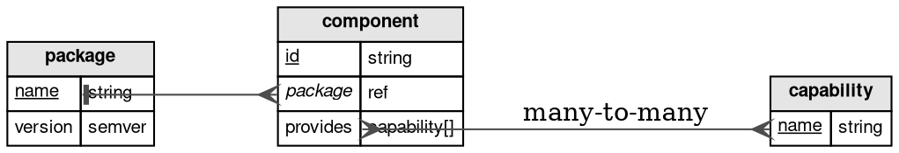

# Pattern: schema / entity-relationship (tables, config schemas, message structs)

Answers: which entities exist, their key fields, and which field references which.

## Template

## Rules

- One HTML table per entity: a header row with the name, then one row per **key or relevant** field. Mark primary keys with `<u>` and foreign keys/references with `<i>`, and say so in the caption.
- Connect **field to field via ports** (`a:field:e -> b:field:w`), so readers see which column links.
- Crow's-foot cardinality: `arrowhead`/`arrowtail` with `tee` (one), `crow` (many), `odot` (zero). Combine them, for example `arrowhead=crowodot` for zero-or-many and `teetee` for exactly one. Set `dir=both`.
- `rankdir=LR` with referenced (parent) entities on the left.
- More than about 8 entities: split by bounded context or subsystem.
- If no build step can render Graphviz, a Mermaid `erDiagram` may be the simpler choice.
