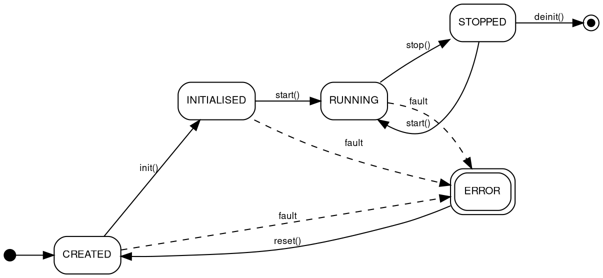

# Pattern: state machine / lifecycle

Answers: which states exist, which events cause transitions, and which states are initial and terminal.

## Template

## Rules

- State names **exactly as in the code** (enum values). Transition labels are events or methods, optionally `event [guard] / action`.
- One initial pseudo-state (filled dot). Terminal states lead to a `doublecircle`.
- Happy path left to right, weighted. Error and back transitions use `constraint=false` so they don't reorder the main path.
- Fan-in for "any of these states → error": `{ a b c } -> error`. For states that are all inside a composite, use a cluster plus `ltail` (`compound=true`).
- Composite states: `subgraph cluster_operational { label="Operational"; ... }`.
- Mark special states with `peripheries=2` (error/safe state), not colour alone.

## Pitfalls

- Using actions as states ("Sending") when they're steps: that's a flowchart.
- Undeclared transitions found in the code are bugs either in the diagram or in the code. Raise them, don't silently add them.
