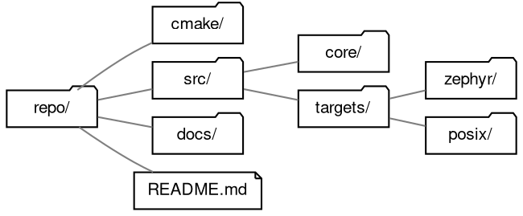

# Pattern: tree / hierarchy (directory layout, ownership, call tree, decision tree)

Answers: what contains or calls what, and how deep the hierarchy goes.

## Template

## Variants

- **Directory tree:** `rankdir=LR`, `folder`/`note` shapes, no arrowheads. For deep trees (more than 3 levels), a plain text tree (`tree -L 2` output in a code block) is often clearer.
- **Call tree:** `rankdir=TB` or `LR`, arrows from caller to callee, monospace function labels (`fontname="Courier"`). Mark recursion with a self-loop.
- **Decision tree:** `rankdir=TB`, diamonds with question labels, every edge labelled (`yes`/`no` or values), leaves as rounded boxes.
- **Ownership/org-style:** `rankdir=TB`, and `ordering=out` to keep children in declaration order.
- **Radial** (one hub, many spokes): `layout=twopi` with `root=hub`.

## Rules

- A tree must have one root and no cross-links. If cross-links are needed, it's a graph, so use the dependency or architecture pattern.
- Use `ordering=out` (graph) so siblings stay in the declared (for example, alphabetical) order.
- Depth of 4 or less and about 25 leaves or fewer. Otherwise collapse subtrees into "… (n more)" nodes.
