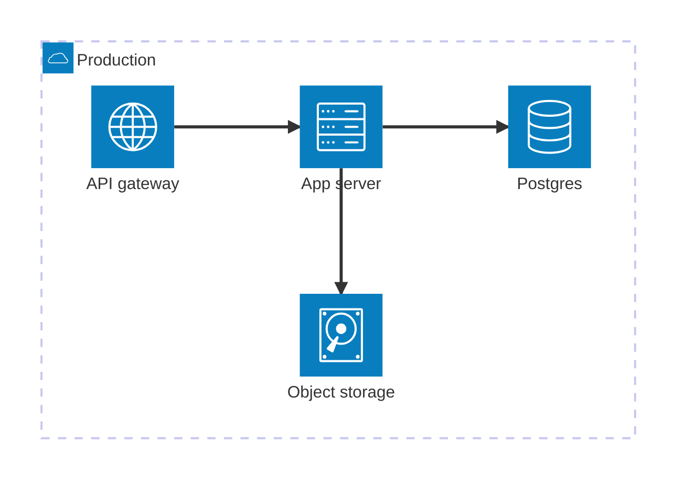

# Architecture diagram (`architecture-beta`, v11.1+)

Contents: Skeleton · Groups and services · Edges · Junctions · Pitfalls · Fallback · Checklist

Use architecture diagrams for cloud and CI/CD topology: services, storage, networks, and gateways grouped by environment or VPC. This type is **beta**: the syntax may change, and older renderers don't support it.

## Skeleton

## Groups and services

- Group: `group id(icon)[Title]`. Nest groups with `in parentId`.
- Service: `service id(icon)[Title] in groupId`.
- Built-in icons: `cloud`, `database`, `disk`, `internet`, `server`. Extra icon packs (for example logos via iconify) must be registered by the host page and **won't work on GitHub**.
- Declare an identifier before you use it in an edge.

## Edges

- Form: `a:SIDE -- SIDE:b`, where SIDE is `T|B|L|R` (the side of each service the edge attaches to).
- Arrows: `a:R --> L:b` (into b), `a:R <-- L:b`, `a:R <--> L:b`.
- Edge from a group boundary: `a{group}:B --> T:b{group}`.
- Choose sides that match the intended flow (for example `R --> L` for left-to-right) so the layout is predictable.

## Junctions

`junction j1` creates a 4-way split point. Use one for fan-out to many services instead of many crossing edges.

## Pitfalls

- Edge labels aren't supported the way they are in flowcharts. If protocols or intents matter, use a flowchart or C4 instead.
- Labels with special characters can break parsing. Keep titles simple.
- Newer layout options (alignment v11.16+, layout tuning v11.15+, randomize v11.14+) aren't portable.

## Fallback

`flowchart LR` with subgraphs per group, `[(…)]` for databases, and labelled edges. This is usually the better choice for GitHub docs.

## Checklist

- [ ] Target renderer supports `architecture-beta` (check with `info`)
- [ ] Only built-in icons unless the host registers packs
- [ ] Edge sides chosen to match the flow direction
- [ ] No reliance on edge labels
