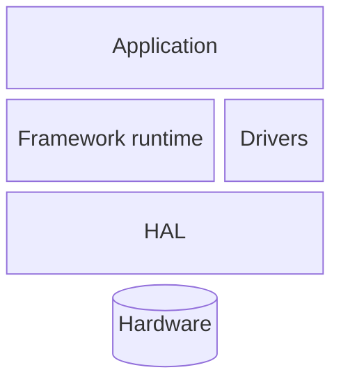
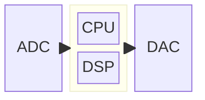

# Block diagram (`block-beta`)

Contents: Skeleton · Columns and spans · Nesting · Shapes, arrows, space · Edges and styling · Pitfalls · Checklist

Use block diagrams when the **author must control placement**: layered software stacks, hardware signal chains, memory/partition maps, and grid-like system overviews. Unlike flowcharts, there's no auto-layout. Blocks fill columns left to right, then wrap.

## Skeleton

This draws a layered stack. `:N` sets how many columns a block spans.

## Columns and spans

- `columns N` sets the grid width. Without it, all blocks go on one row.
- `id:N` spans N columns. Plan each row so its spans add up to `columns`.
- `space` (or `space:N`) leaves an empty cell to align things.

## Nesting

- `block:id ... end` creates a composite that occupies one cell of the parent grid. It can declare its own `columns`.

## Shapes, arrows, space

- Shapes follow flowchart syntax: `id["rect"]`, `id("round")`, `id(["stadium"])`, `id[("cylinder")]`, `id(("circle"))`, `id{"rhombus"}`, `id{{"hexagon"}}`.
- Block arrows (decorative): `arrowId<["label"]>(right)`, with directions `right`, `left`, `up`, `down`, `x`, `y`.

## Edges and styling

- Edges: `a --> b`, `a -- "label" --> b`. Use them sparingly, because the layout doesn't route around blocks.
- `style id fill:…` and `classDef` work (see `styling.md`). Avoid hard-coded colours for GitHub.

## Pitfalls

- Spans that don't fill a row produce ragged layouts. Count spans per row.
- Keyword: newer Mermaid also accepts `block`, but use `block-beta` for older renderers.
- Too many edges make it messy. If the relationships matter more than the placement, use a flowchart.

## Checklist

- [ ] Placement actually matters (otherwise use flowchart)
- [ ] `columns` set; spans per row sum correctly
- [ ] Composite blocks for grouping; ≤ 2 nesting levels
- [ ] Few edges, all meaningful
