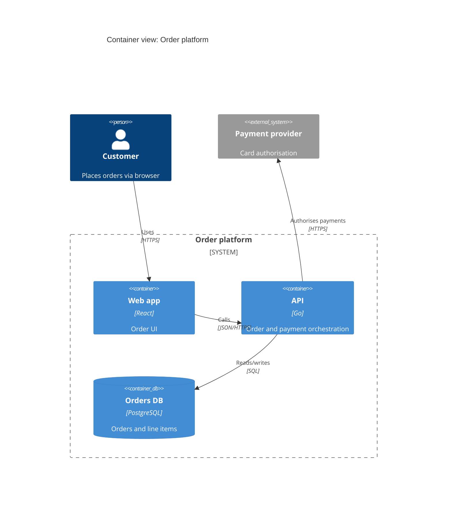

# C4 diagrams (`C4Context`, `C4Container`, `C4Component`, `C4Dynamic`, `C4Deployment`)

Contents: Levels · Skeleton · Elements · Relationships · Pitfalls · Fallback · Checklist

Use C4 when the documentation follows the C4 model (context → container → component). Mermaid's C4 support is **experimental**: the syntax follows C4-PlantUML, and layout is mostly driven by declaration order. Styling or layout controls may change.

## Levels

Pick one per diagram.

| Keyword | Answers | Typical elements |
|---|---|---|
| `C4Context` | What is the system and who/what uses it? | `Person`, `System`, `System_Ext` |
| `C4Container` | What deployable/runnable units make up the system? | `Container`, `ContainerDb`, `ContainerQueue` inside `System_Boundary` |
| `C4Component` | What's inside one container? | `Component`, `ComponentDb` inside `Container_Boundary` |
| `C4Dynamic` | How do elements collaborate for one scenario? | Numbered `Rel`s (prefer a sequence diagram for portability) |
| `C4Deployment` | Where does it run? | `Deployment_Node`, `Node` |

## Skeleton

## Elements

- Signature: `Element(alias, "Label", "Technology", "Description")`. Technology applies to containers and components. Context-level elements take `(alias, "Label", "Description")`.
- External variants: append `_Ext` (`System_Ext`, `Container_Ext`, `Person_Ext`).
- Store variants: `SystemDb`, `ContainerDb`, `ComponentDb`. Queue variants: `SystemQueue`, `ContainerQueue`, `ComponentQueue`.
- Boundaries: `Enterprise_Boundary`, `System_Boundary`, `Container_Boundary`, `Boundary(alias, "Label", "type")`, each with `{ ... }`.

## Relationships

- `Rel(from, to, "Label", "Technology")`. Label it with intent ("Reads orders from"), and put the protocol in Technology.
- `BiRel` for bidirectional links (use sparingly). `Rel_U/Rel_D/Rel_L/Rel_R` hint direction.
- `UpdateRelStyle(from, to, $offsetX="…", $offsetY="…")` nudges overlapping labels. `UpdateLayoutConfig($c4ShapeInRow="3", $c4BoundaryInRow="1")` controls wrapping.

## Pitfalls

- Mixing levels (components in a context diagram) defeats the purpose of C4. Use one level per diagram.
- Rendering quality is limited (overlapping labels are common). Keep it to 10 or fewer elements, and declare them in the order you want them to appear.
- Not every PlantUML C4 macro is supported. Stick to the ones listed above.

## Fallback

If the renderer is untrusted or the result is cluttered, use a `flowchart LR`: subgraphs for boundaries, `[(…)]` for databases, `([…])` for persons, and node labels like `"API Go"`. Keep the C4 vocabulary in labels and edge text.

## Checklist

- [ ] One C4 level per diagram; level stated in the title
- [ ] Every element has a description; containers/components have technology
- [ ] Every `Rel` has an intent label and protocol/technology
- [ ] External systems use `_Ext`
- [ ] ≤ ~10 elements; fallback considered for GitHub
