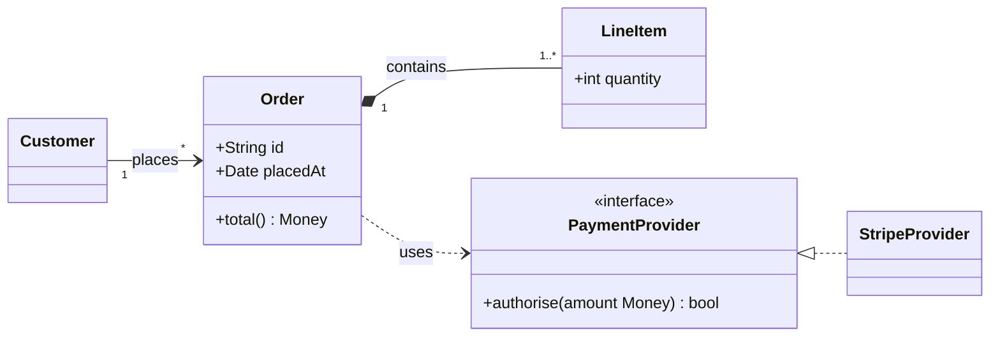

# Class diagram (`classDiagram`)

Contents: Skeleton · Members · Relationships · Grouping and annotations · Patterns · Pitfalls · Checklist

Use class diagrams for code structure: types, interfaces, inheritance, ownership, and dependencies. Use them for domain models when behaviour (methods) matters. For persisted data with keys and cardinality, use ER instead.

## Skeleton

## Members

- Visibility: `+` public, `-` private, `#` protected, `~` package/internal.
- Method: `+name(param Type) ReturnType`. Attribute: `+Type name` or `+name: Type`. Pick one style per diagram.
- Static: suffix `$` (`+create()$`). Abstract: suffix `*` (`+draw()*`).
- Generics: `class Repo~T~`, `List~Order~` (use tildes, not `<>`).
- Show only the members that matter to the doc's point. Leave private details out.

## Relationships

Choose the arrow by semantics, not looks.

| Syntax | UML meaning | Use when |
|---|---|---|
| `A <\|-- B` | Inheritance (B extends A) | Subclassing |
| `A <\|.. B` | Realisation (B implements A) | Interfaces / traits / protocols |
| `A *-- B` | Composition (A owns B's lifecycle) | Parts can't outlive the whole |
| `A o-- B` | Aggregation (A has B, shared lifecycle) | Collections of independent objects |
| `A --> B` | Association (A references B) | Fields / navigable references |
| `A ..> B` | Dependency (A uses B transiently) | Parameters, factories, call-time use |
| `A -- B` / `A .. B` | Link (solid / dashed), no semantics | Avoid unless intentionally vague |

- Cardinality: `A "1" --> "0..*" B : label`. Add it to associations whose multiplicity isn't obvious.
- Label relationships with verbs (`: places`, `: creates`).

## Grouping and annotations

- Annotations: `<<interface>>`, `<<abstract>>`, `<<enumeration>>`, `<<service>>`. Write them on a line inside the class body, or as `<<interface>> Shape`.
- `namespace Billing { class Invoice  class Payment }` groups related classes, for example by module or package.
- `note for Order "Aggregate root"` attaches a note.
- `direction LR|TB` sets layout.

## Patterns

- **Module/package view:** use one namespace per module and only cross-module relationships, which surfaces coupling.
- **Plugin / provider architecture:** draw the interface plus 1–2 implementations with `<|..`, and the consumer with `..>` to the interface (shows dependency inversion).
- **Enumerations:** `class Status { <<enumeration>> DRAFT ACTIVE RETIRED }`.

## Pitfalls

- Using `<>` in generics breaks parsing. Use `~T~`.
- Mixing composition and aggregation arbitrarily misleads readers. When unsure, use plain association.
- Diagramming every class in a package: cap it at about 12 classes and split by concern.
- Class names with spaces or special characters: use a label, `class authSvc["Auth service"]`.

## Checklist

- [ ] Relationship arrows match the actual semantics (inherit/implement/own/use)
- [ ] Interfaces and abstracts annotated
- [ ] Only relevant members shown; one member-syntax style
- [ ] Cardinalities where not obvious
- [ ] `accTitle`/`accDescr` present
