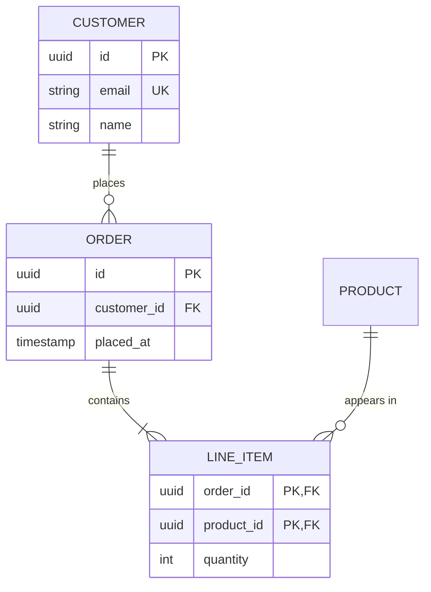

# Entity-relationship diagram (`erDiagram`)

Contents: Skeleton · Cardinality · Attributes · Patterns · Pitfalls · Checklist

Use ER diagrams for data models: database schemas, persisted entities, and message/config schemas with cardinalities. For behaviour and methods, use a class diagram.

## Skeleton

## Cardinality (crow's foot)

Read each side from the entity next to it: `LEFT <left-marker>--<right-marker> RIGHT`.

| Marker (left side / right side) | Meaning |
|---|---|
| `\|o` / `o\|` | Zero or one |
| `\|\|` / `\|\|` | Exactly one |
| `}o` / `o{` | Zero or more |
| `}\|` / `\|{` | One or more |

- `--` is an **identifying** relationship (solid line): the child can't exist without the parent. `..` is **non-identifying** (dashed).
- The relationship label is mandatory. Use a verb phrase from the left entity's perspective, and quote it if it has spaces (`: "appears in"`).

## Attributes

- Format: `type name [PK|FK|UK[, ...]] ["comment"]`.
- Logical model: omit FKs (the relationships already show them). Physical model: include FKs and mark them `FK`. Say which one the diagram is.
- Show key and business-relevant columns only. Leave out audit columns unless they're the point.

## Patterns

- **Many-to-many:** draw the join table explicitly as an entity with two `||--o{` relationships.
- **Bounded contexts / large schemas:** use one diagram per context. Repeat shared entities (with no attributes) at the boundary instead of drawing one huge diagram.
- **Entity naming:** singular nouns, consistent case (`ORDER` or `Order`), and underscores or hyphens rather than spaces. Aliases: `ORDER["Customer order"]` (newer versions; verify).

## Pitfalls

- Spaces in entity names break parsing. Use `_`/`-`, or an alias on supported versions.
- Optional attribute types (v11.16+) and ER subgraphs (v11.17+) aren't portable. Avoid them for GitHub unless verified.
- Wrong marker side: double-check by reading "one CUSTOMER places zero or more ORDERs".

## Checklist

- [ ] Singular entity names, consistent case
- [ ] Every relationship labelled; cardinalities verified by reading them aloud
- [ ] Identifying vs non-identifying chosen deliberately
- [ ] Logical vs physical stated; keys marked
- [ ] `accTitle`/`accDescr` present
