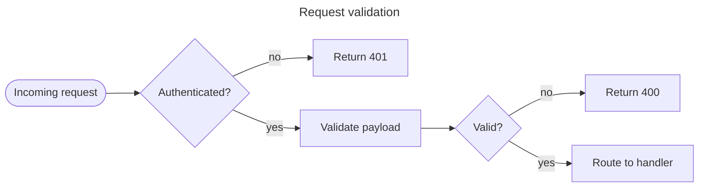
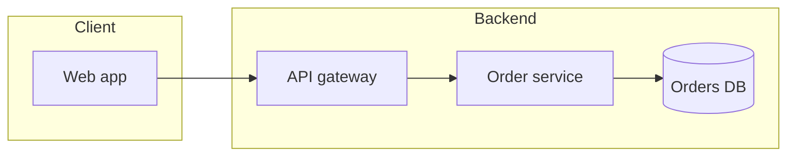

# Flowchart (`flowchart`)

Contents: Skeleton · Nodes and shapes · Edges · Subgraphs · Patterns · Pitfalls · Checklist

Use flowcharts for process and decision logic, pipelines, and component/dependency overviews (with subgraphs). Use `flowchart`, not the legacy `graph` keyword. `flowchart` supports subgraph direction and newer features.

## Skeleton

Directions: `TB`/`TD` (top-down), `BT`, `LR`, `RL`.

## Nodes and shapes

Give each shape one meaning and use it the same way everywhere.

| Shape | Syntax | Use for |
|---|---|---|
| Rectangle | `id[Text]` | Action / step / component |
| Rounded | `id(Text)` | Soft step, sub-process |
| Stadium | `id([Text])` | Start / end terminal |
| Diamond | `id{Text?}` | Decision (label as a question) |
| Cylinder | `id[(Text)]` | Database / persistent store |
| Subroutine | `id[[Text]]` | Call into another documented flow |
| Hexagon | `id{{Text}}` | Preparation / config step |
| Parallelogram | `id[/Text/]` | Input / output |
| Circle | `id((Text))` | Connector / junction |
| Asymmetric | `id>Text]` | Signal / event |

- Text labels: `id["Text with (parens): ok"]`. Markdown labels: ``id["`**bold** _italic_`"]``.
- Expanded shapes (v11.3+): `id@{ shape: doc, label: "Report" }`. Use them only if the renderer is verified (see SKILL.md rendering targets).
- Define a node's label once, at first use. Later references use just the ID.

## Edges

| Syntax | Meaning |
|---|---|
| `A --> B` | Flow / dependency (default) |
| `A --- B` | Association without direction |
| `A -.-> B` | Optional, async, or weak dependency |
| `A ==> B` | Main / happy path (use sparingly) |
| `A -->\|label\| B` or `A -- label --> B` | Labelled edge (use the pipe form) |
| `A <--> B` | Bidirectional |
| `A --o B`, `A --x B` | Circle / cross end |
| `A ---> B` | Longer edge (each extra dash adds rank) |
| `A --> B & C` | Fan-out shorthand |
| `A --> B --> C` | Chaining |

- Edge IDs and animation (`e1@-->`, v11.10+) aren't portable. Avoid them for GitHub.
- Use one line style per meaning, and state the meaning in a legend or the text when you use more than one style.

## Subgraphs

- Give subgraphs an ID and a quoted title: `subgraph backend["Backend"]`.
- `direction` inside a subgraph is ignored if any node in it links to a node outside it. Link to the **subgraph ID** instead when that matters.
- You can link edges to and from a subgraph ID (`ui --> backend`).
- Nest at most 2 levels. Deeper nesting makes the layout unpredictable.

## Patterns

- **Decision tree:** label diamonds as questions and give every outgoing edge a label (`yes`/`no` or values).
- **Pipeline / CI:** use `LR`, one node per stage, and dotted edges for optional stages.
- **Component overview:** use one subgraph per deployable or layer and label edges with the protocol (`-->|gRPC|`). If it grows beyond about 15 nodes, move to C4 or split it.
- **Error paths:** route them to shared terminal nodes instead of duplicating "fail" nodes.

## Pitfalls

- A lowercase `end` as a node ID or label breaks parsing. Use `End`/`done`.
- `A---oB` / `A---xB` creates circle/cross edges. Write `A --- oB` or `A---OB`.
- Unquoted labels with `()`, `[]`, `{}`, `:`, `;`, `"`, or `#` break parsing. Quote them, and use `#quot;` for a literal quote.
- Avoid `%%{init: ...}%%` theme overrides. Front matter `config:` is the current mechanism (see `styling.md`).
- Don't use `click` or links on GitHub.

## Fallback role

Flowchart with subgraphs is the fallback for C4, architecture, and block diagrams when the target can't render them.

## Checklist

- [ ] `flowchart` keyword, explicit direction
- [ ] Short IDs, quoted labels where needed, no lowercase `end`
- [ ] Shapes used consistently; diamonds are questions with labelled exits
- [ ] ≤ ~15 nodes or grouped/split
- [ ] `accTitle`/`accDescr` present
