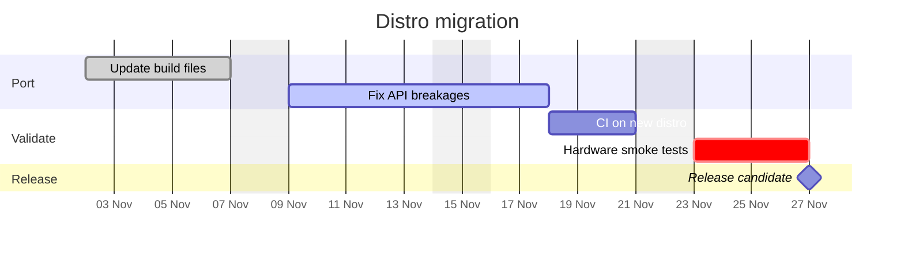

# Gantt chart (`gantt`)

Contents: Skeleton · Tasks · Dates and axes · Pitfalls · Checklist

Use Gantt charts for plans with durations and dependencies: release plans, migration schedules, and milestone tracking. If only the order of milestones matters (no durations), use `timeline`.

## Skeleton

## Tasks

- Format: `Name :[tags,] [id,] start, end|duration`. Tags: `done`, `active`, `crit`, `milestone`, which you can combine (`crit, active`).
- Start can be a date, `after id1 [id2…]` (the latest end wins), or omitted (follows the previous task).
- End can be a date, a duration (`3d`, `2w`, `12h`), or `until id` (newer versions).
- Give every task that others depend on an `id`.

## Dates and axes

- `dateFormat` is the **input** format (dayjs tokens). `axisFormat` is the **display** format (d3 `%` tokens).
- `excludes weekends` and/or specific dates skip days, so durations count working days.
- `todayMarker off` keeps diagrams stable in docs (otherwise the marker moves every day).
- `tickInterval 1week` (newer versions) controls ticks.

## Pitfalls

- A mismatch between `dateFormat` and literal dates gives silent, wrong rendering. Check one task by hand.
- Colons in task names break parsing.
- Plans in docs go stale. Add a "last updated" note in the text, or link to the tracking tool for the live plan.

## Checklist

- [ ] `dateFormat` matches the literals; `axisFormat` readable
- [ ] Dependencies via `after id`; ids on referenced tasks
- [ ] Critical path tagged `crit`; milestones `0d`
- [ ] `todayMarker off` for static docs
