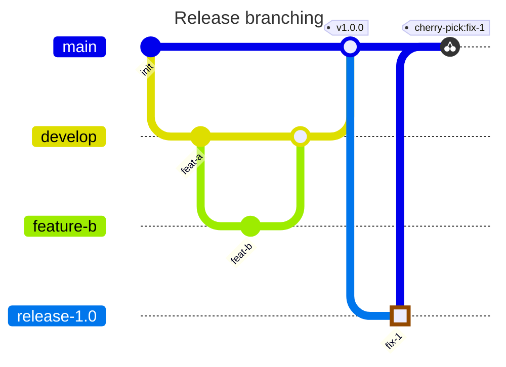

# Git graph (`gitGraph`)

Contents: Skeleton · Commands · Options · Patterns · Pitfalls · Checklist

Use git graphs for branching strategies, release flows, backport/cherry-pick policies, and PR stacking explanations. The diagram is built imperatively: commands run in order, and `main` is the starting branch.

## Skeleton

## Commands

| Command | Notes |
|---|---|
| `commit` | Options: `id: "…"`, `tag: "…"`, `type: NORMAL \| REVERSE \| HIGHLIGHT` |
| `branch name` | Creates the branch and switches to it. Optional `order: N` |
| `checkout name` / `switch name` | The branch must already exist |
| `merge name` | Into the current branch. Accepts `id`, `tag`, `type` |
| `cherry-pick id: "…"` | Source commit must be on another branch. Use `parent: "…"` when picking a merge commit |

## Options

- Orientation: `gitGraph LR:` (default), `gitGraph TB:`, `gitGraph BT:` (v11+). Use `TB:` for long histories in narrow docs.
- Config via front matter: `config: gitGraph: { mainBranchName: "main", showCommitLabel: true, parallelCommits: false }`.

## Patterns

- **Trunk-based / GitHub flow:** `main` plus short-lived feature branches merged back, with tags on releases.
- **Release branches with backports:** fix on `main` and `cherry-pick` it to `release-x.y`, or the reverse. Mark the fix as `HIGHLIGHT`.
- **Stacked PRs:** chain `branch` from the previous feature branch, then show merge order into `main`.

## Pitfalls

- Branch names with special characters need quoting: `branch "feature/foo-bar"`. Prefer simple names.
- Duplicate commit `id`s break parsing. Every `id` must be unique.
- Merging a branch with no new commits causes an error. Add a `commit` first.
- `cherry-pick` of a commit already on the current branch causes an error.
- Random commit IDs make diffs noisy. Set meaningful `id`s on commits you refer to.

## Checklist

- [ ] Branches created before checkout; merges have commits to merge
- [ ] Meaningful unique commit ids on referenced commits; tags for releases
- [ ] Orientation suits the doc width
