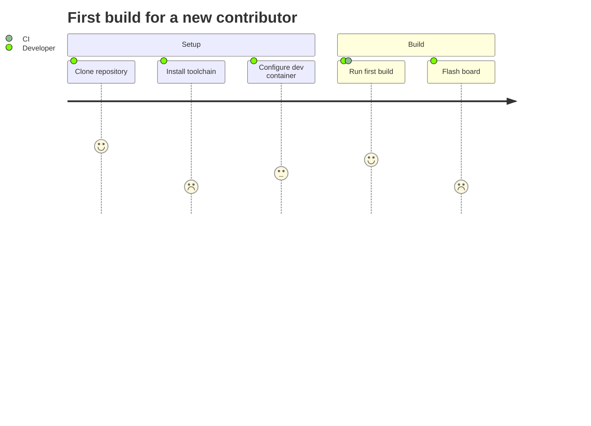

# User journey (`journey`)

Contents: Skeleton · Syntax · Pitfalls · Checklist

Use user journeys for developer or user experience walkthroughs (onboarding, setup, release flow), with a satisfaction score per step. This helps you show friction points in DX docs or proposals.

## Skeleton

## Syntax

- `Task name: score: Actor[, Actor…]`. The score is 1 (worst) to 5 (best).
- `section` groups phases.

## Pitfalls

- Scores are subjective. Say where they come from (survey, team estimate).
- Colons in task names break parsing.
- Don't use a journey for process logic, because it has no branches. Use a flowchart for that.

## Checklist

- [ ] Every task has a score and an actor
- [ ] Score source stated in the text
- [ ] Sections reflect real phases
