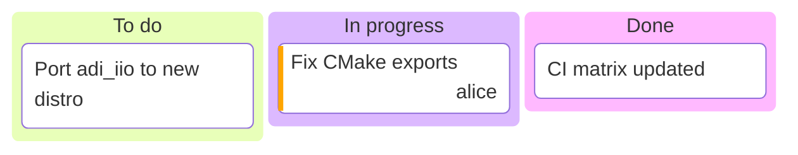

# Kanban (`kanban`)

Contents: Skeleton · Syntax · Pitfalls

Use Kanban boards for a static status snapshot of work items in a doc (for example, a migration tracker in a design doc). For live status, link to the issue tracker instead. This is a newer diagram type, so verify the renderer first.

## Skeleton

## Syntax

- Columns are top-level `id[Title]`. Items are indented under their column as `id[Text]`.
- Item metadata: `@{ ticket: 'ABC-1', assigned: 'name', priority: 'Very High|High|Low|Very Low' }`.
- A ticket link base URL is set with front matter `config: kanban: { ticketBaseUrl: 'https://…/#TICKET#' }`.

## Pitfalls

- Indentation defines column membership.
- Snapshots go stale fast. Date the snapshot in the surrounding text.
- If the renderer doesn't support Kanban, use a Markdown table with a Status column.
