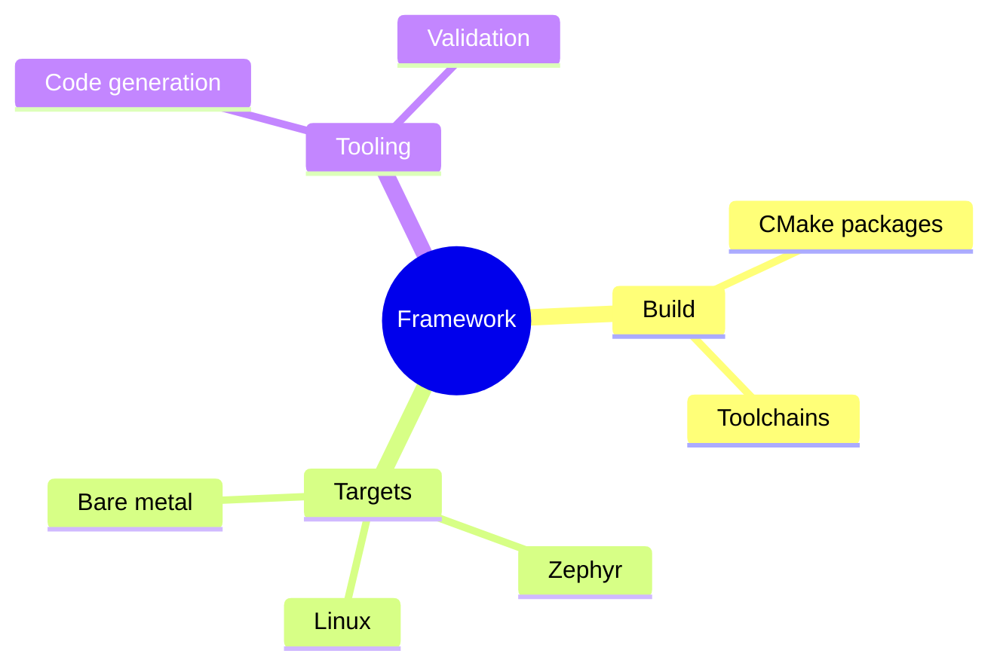

# Mindmap (`mindmap`)

Contents: Skeleton · Syntax · Pitfalls · Checklist

Use mindmaps for hierarchical breakdowns: feature trees, topic overviews, brainstorm results, and doc/navigation structure. If there are cross-links between branches, it's a graph, so use a flowchart.

## Skeleton

## Syntax

- **Indentation defines hierarchy.** Use consistent spaces and never mix tabs and spaces.
- Exactly one root.
- Node shapes: `id[square]`, `id(rounded)`, `id((circle))`, `id))bang((`, `id)cloud(`, `id{{hexagon}}`, or plain text (default).
- Icons (`::icon(fa fa-book)`) need the host to load icon fonts, so they don't work on GitHub. Avoid them.
- Markdown strings: ``id["`**bold** text`"]``.

## Pitfalls

- Inconsistent indentation gives the wrong parent silently. Indent each level by 2 spaces.
- More than 3–4 levels or about 25 leaves gets cluttered. Split into one mindmap per main branch.
- Using shapes decoratively: use the root shape for the root and plain text for everything else, unless a shape carries meaning.

## Checklist

- [ ] Single root; 2-space consistent indentation
- [ ] ≤ 4 levels; ≤ ~25 leaves
- [ ] No icons for GitHub targets
