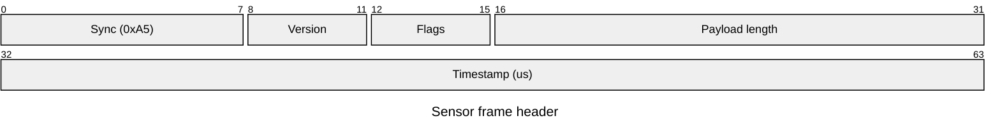

# Packet diagram (`packet-beta`, v11.0+)

Contents: Skeleton · Syntax · Register layouts · Pitfalls · Checklist

Use packet diagrams for bit-level layouts: protocol headers, frame formats, register maps, and packed structs.

## Skeleton

## Syntax

- `start-end: "Field"` for a range, `n: "Field"` for one bit. Ranges are inclusive, zero-based, and in ascending order.
- Relative widths (v11.7+): `+8: "Field"` continues from the previous field. You can mix it with absolute ranges. Use absolute ranges for portability.
- Front matter `config: packet: { bitsPerRow: 32, showBits: true }`. `bitsPerRow: 16` suits 16-bit registers.
- Keyword: newer Mermaid also accepts `packet`. Use `packet-beta` for older renderers.

## Register layouts

- Network convention draws bit 0 on the left (the default).
- Hardware convention draws the MSB on the left. Use `bitOrder: descending` (v12+ only). On older renderers, state "bit 0 = leftmost" in the text instead.
- Declare fields lowest bit first, even with descending order.
- Mark reserved bits explicitly (`"RSVD"`). Don't leave gaps.

## Pitfalls

- Gaps or overlaps in ranges cause parse errors or misleading output. Ranges must be contiguous.
- Long field names in narrow fields overflow. Abbreviate them, and explain the abbreviations in a table below the diagram.

## Checklist

- [ ] Contiguous, ascending, inclusive ranges; reserved bits named
- [ ] Bit-order convention stated
- [ ] `packet-beta` keyword unless v12+ is confirmed
