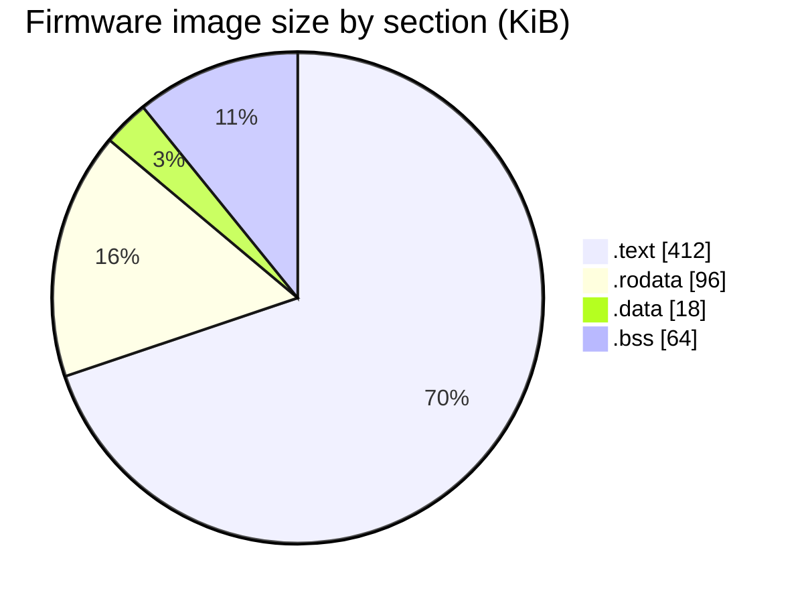

# Pie chart (`pie`)

Contents: Skeleton · Syntax · When not to use

Use pie charts for parts of a single whole with about 6 or fewer slices that differ clearly (for example, binary size by section or test distribution by type).

## Skeleton

## Syntax

- `"Label" : value`, where values are positive numbers. Mermaid computes the percentages.
- `showData` shows the raw values in the legend. Use it, because readers can't judge angles precisely.
- Put the unit in the title.

## When not to use

- More than 6 slices, similar values, or comparison across groups: use `xychart-beta` bars or a table.
- Values that don't add up to a meaningful whole: use a bar chart.
