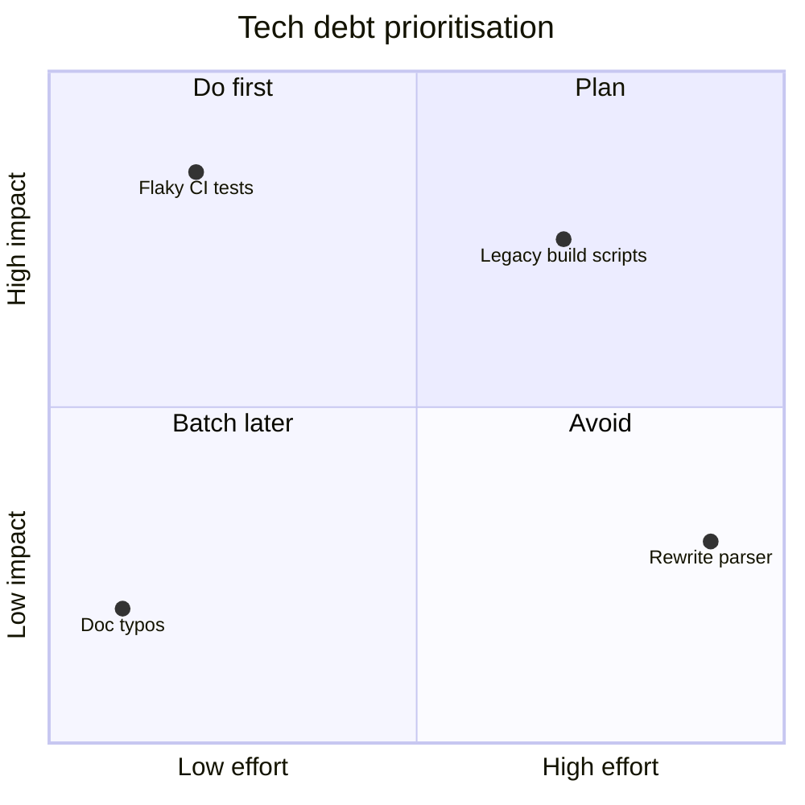

# Quadrant chart (`quadrantChart`)

Contents: Skeleton · Syntax · Pitfalls

Use quadrant charts for positioning items on two axes: effort vs impact, risk vs likelihood, or tech-debt prioritisation in proposals and ADRs.

## Skeleton

## Syntax

- `x-axis Left label --> Right label`, `y-axis Bottom label --> Top label`.
- Quadrant numbering: **1 = top-right, 2 = top-left, 3 = bottom-left, 4 = bottom-right**.
- Points: `Name: [x, y]`, with x and y in the range 0–1.
- Optional point styling: `Name:::cls: [x, y]` with `classDef`, or inline `radius: 8, color: #hex`. Use these only when they carry meaning.

## Pitfalls

- Mixing up the quadrant numbers. Always check which label lands top-right.
- Point positions suggest precision. State that the scores are estimates and how they were derived.
- Colons in point names break parsing.
