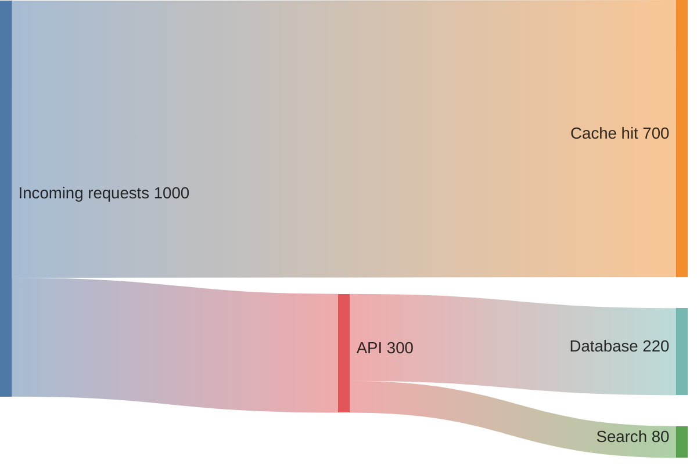

# Sankey diagram (`sankey-beta`)

Contents: Skeleton · Syntax · Pitfalls

Use Sankey diagrams for quantities flowing and splitting between stages: request routing volumes, CI time breakdown, memory budget allocation, or power budgets.

## Skeleton

## Syntax

- CSV body: `source,target,value`, one flow per line. Nodes are created implicitly.
- Quote fields that contain commas: `"Build, test",Deploy,12`. Escape quotes by doubling them (`""`).
- Empty lines are allowed. Comments use `%%`.
- Front matter `config: sankey: { showValues: true, linkColor: source|target|gradient, nodeAlignment: justify|left|right|center }`.

## Pitfalls

- Cycles aren't supported. Flows must form a DAG.
- Inflow and outflow imbalance at a node is allowed but confusing. Make it intentional or add a "loss/other" target.
- No units are rendered, so state them in the title or text.
- Keyword: use `sankey-beta` for portability (newer versions also accept `sankey`).
