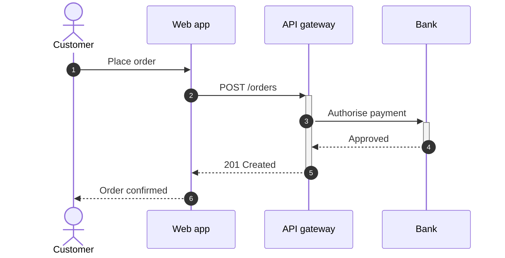

# Sequence diagram (`sequenceDiagram`)

Contents: Skeleton · Participants · Messages · Control blocks · Notes and numbering · Patterns · Pitfalls · Checklist

Use sequence diagrams for time-ordered interactions between two or more parties: API calls, protocols, auth handshakes, async messaging, and driver/firmware exchanges. Draw one scenario per diagram (happy path, or one named failure path).

## Skeleton

## Participants

- Declare participants explicitly, **in the order they should appear left to right** (callers on the left, dependencies on the right).
- Use short aliases: `participant A as API gateway`. Messages then use `A`.
- `actor` draws a stick figure for humans and external users. Use `participant` for systems.
- Typed participants (newer Mermaid: `database`, `queue`, `boundary`, `control`, `entity`, `collections`) aren't portable. Verify the renderer first.
- Group participants with `box`: `box "Backend" ... end` (colour optional: `box rgb(…) "Backend"`; skip colours for GitHub).
- Lifecycle (v10.3+): `create participant X` immediately before X's first message, and `destroy X` before X's last message.

## Messages

| Arrow | Meaning |
|---|---|
| `->>` | Synchronous call / request |
| `-->>` | Response / return |
| `-)` | Async message (fire-and-forget, event) |
| `--)` | Async reply |
| `-x` / `--x` | Lost / failed message |
| `->` / `-->` | Line without arrowhead (rarely needed) |

- Message text after `:` should be concrete: `GET /users/{id}`, `publish OrderCreated`, `ACK (seq=42)`.
- Activation: append `+` to the call and `-` to the reply (`A->>+B` … `B-->>-A`), or use `activate X` / `deactivate X`. Always balance them.

## Control blocks

All blocks close with `end`.

| Block | Use for |
|---|---|
| `alt cond` / `else cond` / `end` | Mutually exclusive branches |
| `opt cond` / `end` | Optional step |
| `loop every 5s` / `end` | Repetition, retries, polling |
| `par A` / `and B` / `end` | Concurrent sends |
| `critical desc` / `option fail` / `end` | Must-succeed section with handled failure |
| `break cond` / `end` | Abort the flow (exception) |
| `rect rgb(…)` / `end` | Background highlight (avoid on GitHub dark mode) |

Keep nesting to 2 levels or less. If `alt` branches get long, split them into separate diagrams.

## Notes and numbering

- `Note right of A: text`, `Note over A,B: text`. Use notes for invariants, timing, or protocol details, not for narration.
- `autonumber` numbers messages so prose can reference steps ("in step 4…").
- Line breaks in messages and notes: ` `.

## Patterns

- **Request/response with failure:** happy path, then `alt` for the error status. Or draw two diagrams if each path has more than 3 messages.
- **Async/event-driven:** `-)` to the broker, then a separate `-)` from the broker to consumers. Mark consumers with `par` if they run in parallel.
- **Retry/backoff:** `loop` with a condition label (`loop up to 3 times`) containing `alt` for success/failure.
- **Auth flows (OAuth/OIDC):** use an `actor` for the user and the browser as a participant. Number the steps.

## Pitfalls

- A lowercase `end` inside message text or participant names can break parsing. Wrap it: `(end)`, `"end"`, or `[end]`.
- `;` in a message is a statement separator. Use `#59;` instead.
- Unbalanced `+`/`-` activations cause rendering errors.
- Too many participants (> 6–7) make the diagram unreadable. Merge internal components or split by layer.

## Checklist

- [ ] One scenario; participants declared in left-to-right order with aliases
- [ ] Correct sync/async/reply arrows; activations balanced
- [ ] Blocks closed with `end`; nesting ≤ 2
- [ ] `autonumber` if prose refers to steps
- [ ] `accTitle`/`accDescr` present
