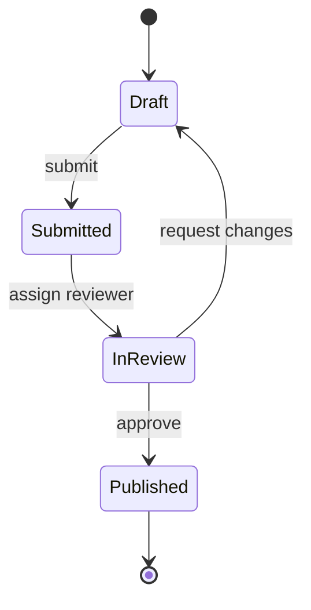

# State diagram (`stateDiagram-v2`)

Contents: Skeleton · States and transitions · Composite, choice, fork, concurrency · Patterns · Pitfalls · Checklist

Use state diagrams for lifecycles and finite state machines: job/order/connection status, protocol states, firmware modes, UI states. Nodes are states the system **rests in**. Edges are **events/triggers**. Always use `stateDiagram-v2` (the plain `stateDiagram` is the older renderer).

## Skeleton

## States and transitions

- `[*] --> S` is the initial state and `S --> [*]` is a final state. Every machine needs exactly one entry.
- Descriptions: `state "Waiting for ACK" as WaitAck`, or `WaitAck : Waiting for ACK`.
- Transition labels: `A --> B : event [guard] / action`. Use the same event vocabulary as the code (enum or method names).
- `direction LR` for wide, shallow machines.

## Composite, choice, fork, concurrency

```mermaid
stateDiagram-v2
    accTitle: Device operating modes
    accDescr: Active mode toggles idle and running; faults are recovered or fail permanently.

    [*] --> Active
    state Active {
        [*] --> Idle
        Idle --> Running : start
        Running --> Idle : stop
    }
    state check <<choice>>
    Active --> check : fault
    check --> Recovering : recoverable
    check --> Failed : fatal
    Recovering --> Active
    Failed --> [*]
```

- Composite: `state Name { ... }` has its own `[*]` entry. Nest at most 2 levels.
- Choice: `state x <<choice>>` for guard-based branching. Label every outgoing edge.
- Fork/join: `state f <<fork>>`, `state j <<join>>` for parallel paths that split and rejoin.
- Concurrent regions: separate them with `--` inside a composite state.
- Notes: `note right of S` … `end note`, or a one-line `note left of S : text`.

## Patterns

- **Enum to diagram:** one state per enum value, and one transition per method/event that changes it. Missing transitions in the diagram often reveal bugs or undocumented behaviour.
- **Error handling:** group normal operation in a composite and add a single `fault` transition out of the composite instead of one per inner state.
- **Connection/protocol FSMs:** label transitions with the message or timer (`timeout(5s)`).

## Pitfalls

- A lowercase `end` as a state name breaks parsing.
- State IDs with spaces: use `state "Long name" as id`.
- Modelling actions as states (`SendEmail`) means you want a flowchart.
- `classDef` styling can't be applied to `[*]` or to composite states in all versions. Keep styling minimal.

## Checklist

- [ ] `stateDiagram-v2`; single `[*]` entry; terminal states lead to `[*]` where applicable
- [ ] States are nouns/adjectives; transitions are events (verbs) matching code names
- [ ] Choices have labelled exits; composites ≤ 2 levels
- [ ] `accTitle`/`accDescr` present
