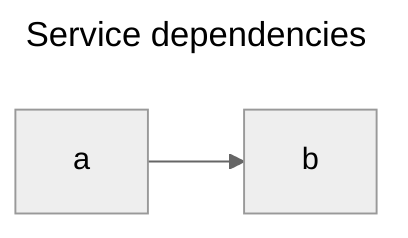
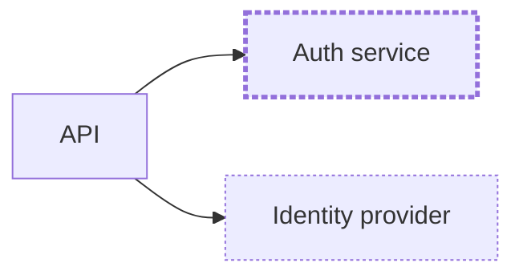

# Styling, theming, and configuration (cross-cutting)

Contents: Principles · Front matter config · classDef and class · Themes · Accessibility · Pitfalls

Load this only when a diagram needs emphasis, a legend, or renderer configuration. The default is **no styling**.

## Principles

- Styling must encode meaning (status, ownership, "changed in this PR"), never decoration.
- Use at most 2–3 classes per diagram, and explain them in a legend node or in the text.
- The diagram must remain understandable in greyscale and in dark mode. Pair colour with a shape, line style, or label suffix such as "(new)".

## Front matter config

Front matter is the preferred mechanism. It must be the first lines of the block:

- `%%{init: { ... }}%%` directives are the older mechanism. Use them only if the target renderer rejects front matter.
- Keep config per diagram. Site-wide config belongs in the host (MkDocs/Docusaurus settings), not in every block.
- On Mermaid v12, several types default to the `neo` look, the `redux-color` theme, and ELK layout. Set `look: classic`, `theme: default`, and `layout: dagre` to get the pre-v12 appearance.

## classDef and class

- `classDef name prop:val,prop:val`, then apply it with `id:::name` or `class id1,id2 name`.
- Prefer stroke width and dash patterns over fill colours: they survive light and dark themes.
- `style id prop:val` is for one-offs. Avoid it, because classes are easier to maintain.
- Edges: `linkStyle 0,2 stroke-width:2px` (indexes are by declaration order, so they're fragile). Use them sparingly.
- Support differs by type: flowchart, class, state, and block support `classDef`. ER, gantt, and others have their own limited options.

## Themes

- Built-in themes: `default`, `neutral` (best for print and greyscale), `dark`, `forest`, `base` (the only one customisable via `themeVariables`).
- GitHub picks light/dark automatically. Setting a theme overrides that, so avoid it unless the doc is rendered elsewhere.

## Accessibility

- `accTitle: …` and `accDescr: …` (or a multi-line `accDescr { … }`) right after the header line. Most diagram types support them.
- Don't rely on colour alone. Provide text equivalents.

## Pitfalls

- Hex fills that look fine in light mode are often unreadable in dark mode on GitHub.
- `themeVariables` work only with `theme: base`.
- Over-styled diagrams produce noisy diffs and drift from the house style.
