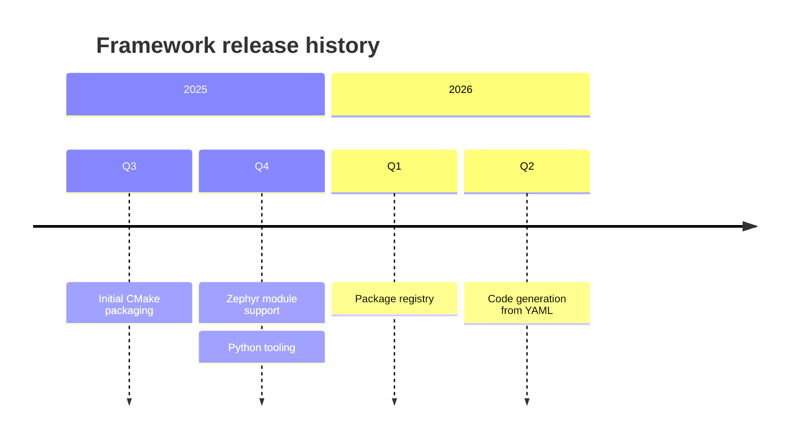

# Timeline (`timeline`)

Contents: Skeleton · Syntax · Pitfalls · Checklist

Use timelines for history, roadmaps, and release chronologies where **order and periods** matter but durations and dependencies don't. Use `gantt` when they do.

## Skeleton

## Syntax

- `period : event` per line. Add more events to the same period with additional `: event` (on the same line or on the next lines starting with `:`).
- `section Name` groups periods (years, phases, major versions).
- Periods are free text (`v1.0`, `2026-Q1`, `Sprint 12`). Keep them uniform.
- Front matter `config: timeline: { disableMulticolor: true }` gives a calmer look in docs.

## Pitfalls

- Long event texts wrap badly. Keep events to about 6 words and put detail in the prose.
- Colons inside event text are separators. Rephrase or avoid them.
- More than about 12 periods gets too wide. Split by section into multiple timelines.

## Checklist

- [ ] Uniform period naming; sections for grouping
- [ ] Short events; no stray colons
- [ ] ≤ ~12 periods
