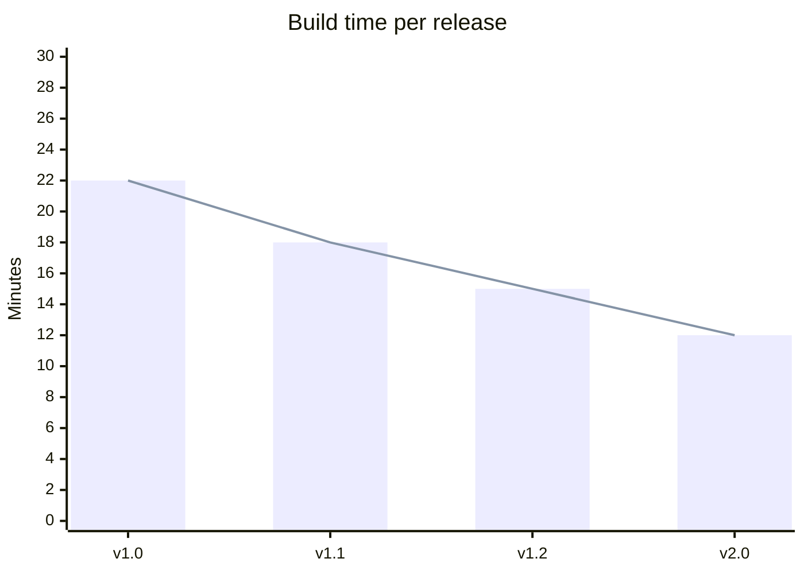

# XY chart (`xychart-beta`)

Contents: Skeleton · Syntax · Pitfalls · Checklist

Use XY charts for bar and line charts of numeric data across categories or ordered values: benchmark results, build times, memory usage per release, and test trends.

## Skeleton

## Syntax

- `xychart-beta horizontal` gives horizontal bars. The default is vertical.
- `x-axis [a, "b c", d]` for categorical axes, or `x-axis "Title" min --> max` for numeric axes.
- `y-axis "Title" min --> max` (numeric only). Omit the range to auto-scale.
- Series: `bar [..]`, `line [..]`. Every array length must equal the number of categories.
- Named series appear in a legend (v11.17+): `line "p95" [..]`. On older renderers, the name may not show, so describe the series in the text.
- Quote any text with spaces.

## Pitfalls

- Start the y-axis at 0 for bar charts. A truncated axis exaggerates differences.
- Showing several series without a legend is ambiguous on older renderers. Use one series per chart or explain the colours in the text.
- Keyword: newer Mermaid also accepts `xychart`. Use `xychart-beta` for portability.
- For exact values, put a table next to or instead of the chart.

## Checklist

- [ ] Units in the axis title; bar charts start at 0
- [ ] Array lengths match categories
- [ ] Series identified (legend or text)
